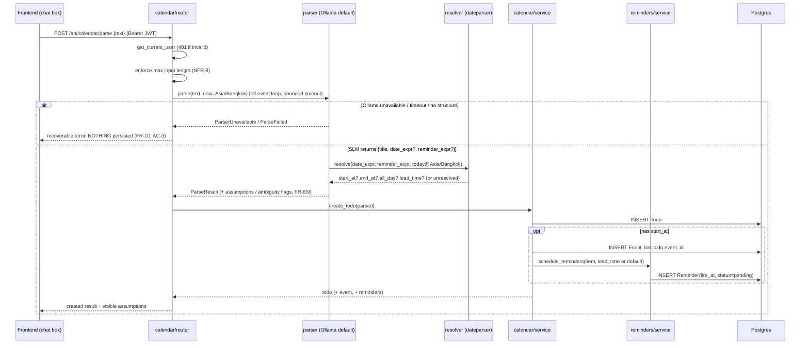
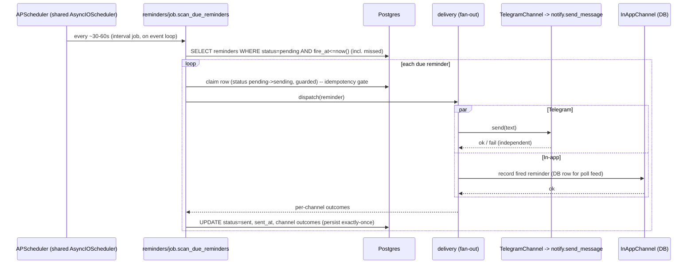
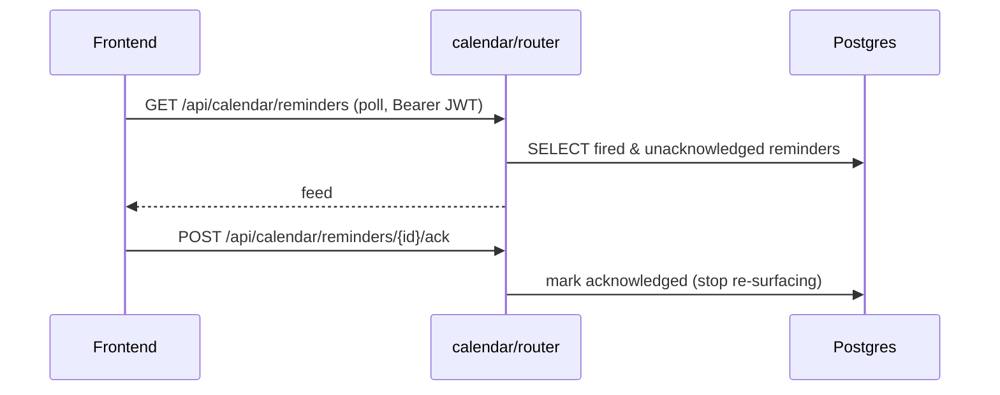

# Calendar + To-Do — System Architecture (Stage 02)

- **Feature slug:** `calendar-todo`
- **Stage:** 02 — System Architecture
- **Status:** Draft — awaiting approval
- **Author:** System Architecture Agent
- **Date:** 2026-11-15
- **Inputs:** `docs/design/calendar-todo/01-requirements.md` (APPROVED)

> Scope note: this document decides *components, responsibilities, data flow, the
> Parser/Delivery abstractions, concurrency/lifecycle, and the tech stack*. It
> does **not** design the detailed SQLAlchemy schema (stage 03) or the concrete
> API payloads/paths (stage 04); those are referenced here only as interfaces.

---

## 0. Context grounded in the existing codebase

Verified by inspecting `src/`:

- **DB layer is fully async** — `core/database.py` exposes `engine =
  create_async_engine(...)` and `SessionLocal = async_sessionmaker(...)` over
  `postgresql+psycopg`. New service code must use `async with SessionLocal()`,
  matching `modules/system/service.py`.
- **Scheduler already exists and is the sampler** — `modules/scheduler/scheduler.py`
  holds a single module-level `AsyncIOScheduler(timezone="Asia/Bangkok")`. Jobs
  (`collect_and_store` every 5s, `clean_system_metric` daily) are registered and
  the scheduler is `.start()`/`.shutdown()` inside the `lifespan` in `main.py`.
  `AsyncIOScheduler` runs coroutine jobs **on the app event loop**.
- **Auth is real** — `modules/auth/jwt.py` exports `get_current_user` (HTTPBearer,
  HS256, 1h tokens, checks `sub == settings.ADMIN_USERNAME`). Reuse as a FastAPI
  dependency. (This confirms requirement A-1; the auth-absent note is wrong.)
- **`notify` module is a placeholder** — `src/modules/notify/` contains only
  `.gitkeep`. **There is no implemented Telegram path yet.** The requirement to
  "reuse `notify` and not open a second Telegram path" is honored by this design,
  but `notify` must be *built* (a thin sender) as part of, or just before, this
  feature. See §9 Open Question O-A and the Handoff.
- **Routers** mount under `prefix="/api"` with a per-module `tags=[...]`, composed
  in `main.py` via `app.include_router(...)`.
- **Models** derive from `core.models.Base` (shared `MetaData` + naming
  convention). Every new models module must be imported in `src/migrations/env.py`
  for autogenerate to see it.
- **Config** is a single `Settings(BaseSettings)` in `core/config.py` reading one
  `.env`. New settings are added there as typed fields — never `os.environ`.

### Module directory name

`src/modules/calendar-todo/` is **not importable** (`-` is illegal in a Python
module path; imports are rooted at `src/`). The module directory is named
**`src/modules/calendar/`** and imported as `modules.calendar.*`. The *feature
slug* remains `calendar-todo` for docs/branches. This is a required deviation
from the literal slug and is called out for approval.

---

## 1. Component breakdown

All new code lives in **`src/modules/calendar/`** unless noted. The slice owns
its router, schemas, models, services, the parser subpackage, and the reminder
subpackage. A small amount is added to `core/` (settings) and the shared
scheduler.

```
src/
├── core/
│   └── config.py                 # (edit) add calendar/parser/reminder settings
├── migrations/
│   └── env.py                    # (edit) import modules.calendar.models
├── modules/
│   ├── scheduler/
│   │   └── scheduler.py          # (edit) register reminder-scan job
│   ├── notify/                   # (build) thin Telegram sender — see §6
│   │   ├── service.py            #   send_message(text) -> bool, config-gated
│   │   └── config/.env fields
│   └── calendar/                 # NEW feature slice
│       ├── router.py             # todo + event + parse + in-app reminder routes
│       ├── schemas.py            # pydantic request/response models (stage 04 fills)
│       ├── models.py             # Todo, Event, Reminder ORM (stage 03 fills)
│       ├── service.py            # todo/event CRUD + link lifecycle orchestration
│       ├── deps.py               # shared Depends (auth alias, parser provider)
│       ├── parser/               # swappable NL parser subpackage
│       │   ├── base.py           # Parser protocol + DTOs + exceptions
│       │   ├── ollama_parser.py  # default: local SLM via Ollama
│       │   ├── claude_parser.py  # optional cloud fallback (Claude API)
│       │   ├── resolver.py       # dateparser resolution (expression -> datetime)
│       │   └── factory.py        # select impl from settings; health/availability
│       └── reminders/            # reminder scheduling + delivery
│           ├── service.py        # compute/recompute fire-times, scan, mark-sent
│           ├── delivery.py       # Channel abstraction + fan-out dispatcher
│           ├── channels.py       # TelegramChannel (-> notify), InAppChannel (DB)
│           └── job.py            # scan_due_reminders() coroutine (APScheduler job)
```

### Responsibilities

**`router.py`** — defines the auth-gated endpoints. Every route takes
`user: str = Depends(get_current_user)` (aliased via `deps.py`). It is thin:
validates/deserializes, calls `service`/`parser`/`reminders`, serializes. Mounts
under `/api` with `tags=["calendar"]`. Logical groups: `/calendar/todos*`,
`/calendar/events*`, `/calendar/parse`, `/calendar/reminders*`. Exact strings =
stage 04.

**`schemas.py`** — pydantic DTOs for requests/responses (ToDo, Event, Reminder,
parse request/result, in-app reminder feed). The wire timezone decision (§7)
lives here. Stage 04 finalizes shapes.

**`models.py`** — three ORM tables (`Todo`, `Event`, `Reminder`) + sent-state
columns on `Reminder`. Stage 03 designs columns/indexes/constraints. This stage
only fixes the *entity set and relationships* (see §2 / Handoff).

**`service.py`** — the orchestration core for CRUD and the **todo↔event link
lifecycle** (FR-5/6/16/17): create todo; if dated, create+link event; on time
change, create/recompute/clear event; on delete, apply the link rule. It also
triggers **reminder (re)computation** via `reminders.service` whenever a due time
is set/changed/cleared (FR-24/29). Pure async SQLAlchemy, one transaction per
mutation so todo+event+reminder are consistent.

**`deps.py`** — re-exports the auth dependency as a local `CurrentUser` alias and
provides `get_parser()` (returns the configured `Parser` or raises a 503-style
"parser unavailable" signal) so the router never imports a provider directly.

**`parser/`** — the swappable NL parser (see §4).

**`reminders/`** — scheduling + delivery (see §5, §6).

---

## 2. Data entities (for stage 03 — relationships only, not columns)

Three persisted entities, single-operator (no owner column, FR-22):

- **`Todo`** — a task. Has title, optional `start_at`/`end_at`, `all_day`, `done`.
  Optional nullable FK **`event_id → Event`** (separate-but-linked; the todo
  "owns" its event when dated). Retained indefinitely (NFR-23).
- **`Event`** — a calendar time block. Title, `start_at`, optional `end_at`,
  `all_day`. Back-reference to its source todo (if any). Range-queried with
  overlap semantics (FR-18/20).
- **`Reminder`** — a scheduled lead-time notification bound to a *dated* item.
  Carries: the owning todo/event reference, computed **`fire_at`** (absolute
  UTC instant), lead-time spec, and **durable sent-state** (e.g. `status` ∈
  {pending, sent, failed, acknowledged} + `sent_at` + per-channel outcome). The
  sent-state is what makes firing exactly-once and crash-safe (FR-32/33, NFR-18).
  Model must *allow many reminders per item* even if v1 ships one (FR-23, OQ-11).
  In-app acknowledgement state lives here too (FR-31a).

Stage 03 decides: exact columns, the overlap-query indexing on `Event`, the
`fire_at` index for the scan, the link cascade rule (OQ-2), and whether in-app
ack is a column or a separate delivery row.

---

## 3. Data flow

### 3a. Web NL capture → parse → persist todo + event + reminders



Structured create (FR-11, AC-4) is the same path **minus the `P`/`DP` hops** —
the router calls `service.create_todo` directly with explicit fields; no SLM call
is ever issued.

### 3b. Reminder scan → dispatch → Telegram + in-app (background)



In-app retrieval is a **separate pull**, not part of the scan:



---

## 4. Parser abstraction (swappable, hybrid)

### Interface (`parser/base.py`)

A provider-agnostic `Parser` (a `typing.Protocol` / ABC) with a single async
method:

```
async def extract(text: str, *, now: datetime) -> RawExtraction
```

where `RawExtraction` carries **only what an LLM should produce** — `title`, a
free-text `date_expr | None`, a free-text `reminder_expr | None`, and optional
confidence/notes. **The SLM never emits a resolved timestamp** (FR-3a). The
`Parser` raises typed exceptions: `ParserUnavailable` (provider down / not
configured), `ParseTimeout`, `ParseFailed` (no usable structure). Nothing outside
`parser/` imports Ollama, httpx, or Claude — enforced by keeping those imports
inside the impl files (FR-3b, NFR-13).

### Default impl (`parser/ollama_parser.py`)

- Talks to the local Ollama runtime over HTTP via the **async** path (either the
  official `ollama` async client or `httpx.AsyncClient`; see §8 decision).
- One call per parse (NFR-3), `format=json` / structured output, a tight system
  prompt instructing "extract title + rough date phrase + rough reminder phrase,
  do NOT compute dates."
- Sends `keep_alive` short (e.g. `"5m"`, settings-driven) so the ~2.3 GB model
  unloads when idle (NFR-5). Bounded request timeout (NFR-2); on timeout →
  `ParseTimeout`.
- `now` (Asia/Bangkok) is passed into the prompt as "today" context (FR-3).

### Resolver (`parser/resolver.py`) — the deterministic half

- Uses **`dateparser`** to turn `date_expr`/`reminder_expr` into concrete values,
  configured: `TIMEZONE="Asia/Bangkok"`, `RETURN_AS_TIMEZONE_AWARE=True`,
  `PREFER_DATES_FROM="future"`, `RELATIVE_BASE=now` (FR-4). Thai + English both
  supported by `dateparser`.
- If `date_expr` doesn't resolve → treat as **undated/ambiguous** (FR-9a); never
  fabricate a time. If a date resolves but no time → surfaces an `all_day`
  assumption (OQ-4, pending). Reminder expression resolves to a **lead-time
  delta**; absent → apply configured default (FR-24/25/27).
- This is pure-Python and can be CPU-light but still runs **off the event loop**
  with the SLM call (one offload boundary, §5).

### Fallback impl (`parser/claude_parser.py`) — optional

Same interface, calls the Claude API via `httpx`. Selected **by configuration
only** (`CALENDAR_PARSER=ollama|claude`); **no silent runtime auto-fallback**
(OQ-9, privacy NFR-12). Off by default; requires an explicit API-key setting.

### Factory & availability (`parser/factory.py`)

Reads `settings.CALENDAR_PARSER` and returns the configured impl. If the parser
is unconfigured/unreachable, `get_parser()` in `deps.py` makes the **`/parse`
endpoint return a clear 503**, while leaving all CRUD/calendar routes untouched
(NFR-7/14/17). The app always boots regardless of Ollama's state.

---

## 5. Concurrency & lifecycle

### Non-blocking parse (NFR-6)

The parse is the sensitive path: a 2–6 s CPU-bound model call must not stall the
event loop (which also runs the 5s metrics sampler). Strategy:

- The Ollama call uses an **async HTTP client**, so the network wait yields the
  loop. The heavy work runs inside the **Ollama process**, not ours — it does not
  hold the Python GIL.
- The `dateparser` resolution (sync, can be non-trivial) is offloaded with
  **`anyio.to_thread.run_sync` / `asyncio.to_thread`** so it never blocks the loop.
- A single logical offload boundary per parse keeps NFR-3 (one model call) intact.

### Background reminder scan (FR-32/33, NFR-19)

- **Reuse the existing shared scheduler** (`modules/scheduler/scheduler.py`) — do
  **not** create a second scheduler. Add one `interval` job:
  `scan_due_reminders`, every ~30–60 s (settings-driven), `id="scan_reminders"`,
  `replace_existing=True`, registered alongside the sampler jobs in `main.py`'s
  `lifespan`. It is a coroutine job → runs on the event loop, lightweight (an
  indexed `SELECT ... WHERE status=pending AND fire_at<=now()` + a few UPDATEs).
- It shares the loop with the 5s sampler; the scan must stay cheap (indexed query,
  bounded batch) so it never delays sampling (NFR-19). Delivery I/O (Telegram
  HTTP) is `await`ed, yielding the loop.

### Exactly-once & crash safety (FR-32, NFR-18)

- Idempotency is **persisted**, not in-memory: the `Reminder.status` transition
  `pending → sending → sent` is the gate. A row is claimed with a guarded UPDATE
  (`WHERE status='pending'`) before dispatch so a concurrent/duplicate scan can't
  grab it. Single-worker (A-5) makes contention negligible, but the DB gate makes
  it correct regardless.
- A crash mid-dispatch leaves the row in `sending`; on restart the scan treats
  stale `sending` rows (past a small grace) as re-dispatchable, accepting rare
  at-least-once to Telegram — the operator never sees a duplicate because the
  `notify` send is the only observable effect and the grace window is short
  (retry policy exact values = OQ-15).

### Durability across restart + missed catch-up (FR-33/34)

- All pending reminders live in Postgres with `fire_at`; nothing is held only in
  APScheduler. On restart the very first scan naturally picks up every
  `fire_at <= now()` that is still `pending`, including ones whose time passed
  during downtime (AC-13/14). A **catch-up cutoff** (deliver only if less than N
  late, else mark expired) is settings-driven; concrete N = OQ-13.

### Graceful shutdown

The existing `lifespan` already does `scheduler.shutdown()` then `close_db()`.
The reminder job inherits this — APScheduler stops scheduling; any in-flight
dispatch completes or is re-picked next boot (safe due to the DB gate).

---

## 6. Reminder delivery fan-out (reuse notify)

### Channel abstraction (`reminders/delivery.py`, `channels.py`)

A `Channel` protocol: `async def deliver(reminder) -> ChannelResult`. The
`dispatch(reminder)` fan-out calls every enabled channel and collects
**independent** results so one failing channel never blocks another (FR-31,
NFR-20). Adding/removing a channel does not touch scan/scheduling logic.

- **`TelegramChannel`** → calls **`modules.notify.service.send_message(text)`**.
  This is the *single* Telegram path (NFR-22). If `notify` is unconfigured /
  Telegram unreachable, the channel returns a failure result; the reminder still
  succeeds in-app and the app does not crash (graceful degradation, NFR-22).
- **`InAppChannel`** → writes/updates the fired-reminder state in Postgres so the
  polled `GET /api/calendar/reminders` feed surfaces it (FR-30/31a).

> **Dependency gap flagged:** `modules/notify/` is currently a placeholder
> (`.gitkeep` only) — there is no `send_message` yet. This design *reuses* it per
> requirement, but a minimal, config-gated `notify.service.send_message(text) ->
> bool` (Telegram Bot API `sendMessage` via `httpx`, reading
> `TELEGRAM_BOT_TOKEN`/`TELEGRAM_CHAT_ID` from settings) must be implemented. It
> is placed in `notify`, not `calendar`, precisely so there is one Telegram path.
> Whether `notify` is built in-scope here or as a prerequisite stage is **OQ-A**.

---

## 7. Timezone handling (resolves OQ-8 for this stage)

- **Resolve input in Asia/Bangkok** (FR-4): `dateparser` with `TIMEZONE` +
  `RELATIVE_BASE=now_bangkok`, producing tz-aware datetimes.
- **Store and transmit UTC** to match the project convention (A-3, README "UTC")
  and the existing `SystemMetric` pattern (`DateTime(timezone=True)`, UTC compares
  in `system/service.py`). Columns are tz-aware; values persisted as UTC instants.
  `Reminder.fire_at` is a UTC instant so the scan's `fire_at <= now(utc)` is
  trivially correct.
- The frontend converts UTC → Asia/Bangkok for display (A-6). **Recommendation to
  confirm:** keep UTC-on-the-wire for consistency (OQ-8). Range queries (FR-18/20)
  must translate the operator's local day boundaries to UTC before the overlap
  comparison (NFR-10; Bangkok has no DST, simplifying this).

---

## 8. Technology decisions & new dependencies

| Concern | Choice | Rationale |
|---|---|---|
| NL extraction (default) | **Ollama** `qwen2.5:3b-instruct` q4, local HTTP | NFR-4; on-box, private (NFR-12), CPU-only |
| Ollama client | `ollama` async client **or** reuse **`httpx`** | async → non-blocking (NFR-6); httpx avoids a new dep and we already need it for notify + Claude. **Leaning httpx** to minimize deps; see note |
| Date resolution | **`dateparser`** | Thai+EN relative dates, tz + future-preference config (FR-3a/4) |
| Off-loop sync work | stdlib `asyncio.to_thread` / `anyio` (bundled with FastAPI) | no new dep; keeps dateparser off the loop (NFR-6) |
| Background job | **existing `apscheduler`** (`<4`, already a dep) shared `AsyncIOScheduler` | FR-33, reuse sampler pattern; no new dep |
| Cloud fallback | **Claude API via `httpx`** | optional, config-selected (FR-3b, OQ-9) |
| Telegram | **`notify.service` via `httpx`** Bot API | NFR-22, single path; `httpx` promoted to main dep |
| Persistence | existing async SQLAlchemy 2 + Alembic + psycopg3 | project convention |
| Auth | existing `get_current_user` | NFR-11, no new auth |

**New dependencies to add to `pyproject.toml` (main deps):**

- `dateparser` — required, the deterministic resolver.
- `httpx` — **promote from the `dev` group to main deps** (needed by notify,
  Ollama-via-httpx, and the Claude fallback). Currently dev-only.
- `ollama` — **only if** we choose the official client over httpx (decision
  pending; default recommendation: **skip it, use httpx**).
- (optional) `types-dateparser` / stubs in dev for typing — nice-to-have.

**New settings in `core/config.py` (via `.env`, NFR-7):**

- Parser: `CALENDAR_PARSER` (`ollama`|`claude`, default `ollama`),
  `OLLAMA_HOST`, `OLLAMA_MODEL`, `OLLAMA_KEEP_ALIVE`, `PARSE_TIMEOUT_S`,
  `PARSE_MAX_INPUT_CHARS`, optional `ANTHROPIC_API_KEY`/`CLAUDE_MODEL`.
- Reminders: `REMINDER_DEFAULT_LEAD` (default `1 day`, FR-24/25),
  `REMINDER_SCAN_INTERVAL_S` (~30–60), `REMINDER_CATCHUP_WINDOW` (OQ-13).
- Telegram (for notify): `TELEGRAM_BOT_TOKEN`, `TELEGRAM_CHAT_ID`.

`.env.example` must gain these keys.

---

## 9. Reuse map

| Need | Reuse (file) | How |
|---|---|---|
| Auth gating | `modules/auth/jwt.py::get_current_user` | `Depends` on every route (NFR-11) |
| DB sessions | `core/database.py::SessionLocal`, `engine` | `async with SessionLocal()` in services |
| ORM base + naming | `core/models.py::Base` | new models subclass `Base` |
| Migrations wiring | `src/migrations/env.py` | add `import modules.calendar.models` |
| Background scheduling | `modules/scheduler/scheduler.py::scheduler` | add `scan_reminders` job; register in `lifespan` |
| App composition | `src/main.py` | `app.include_router(calendar_router)`; add reminder job to lifespan |
| Config | `core/config.py::Settings` | add typed fields |
| Telegram | `modules/notify/service.py` | `send_message(text)` — **must be built**, single path (NFR-22) |
| Async-service pattern | `modules/system/service.py` | mirror its `async with SessionLocal()` + UTC cutoff style |
| Router conventions | `modules/system/router.py`, `auth/router.py` | `prefix="/api"`, `tags=[...]` |

---

## 10. Risks & trade-offs

- **RAM contention on 8 GB (NFR-5).** Ollama ~2.3 GB competes with Postgres,
  Docker, the metrics backend. *Mitigation:* short `keep_alive` → model unloads
  when idle; accept cold-start on the next parse. *Trade-off:* occasional first
  parse near the top of the 2–6 s budget (OQ-5 tunes the window). The scan job is
  cheap and does not touch the model.
- **Event-loop sharing with the sampler.** The parse and the reminder scan run on
  the same loop as the 5s sampler. *Mitigation:* async Ollama I/O + `to_thread`
  for `dateparser`; keep the scan a bounded indexed query. *Residual risk:* a
  pathological scan batch; bounded by `LIMIT` + indexing (stage 03).
- **`notify` does not exist yet.** The feature depends on a Telegram sender that
  is currently a placeholder. *Risk:* scope creep / ordering. *Mitigation:* build
  a minimal config-gated `send_message` in `notify`; channels fail independently
  so missing/broken Telegram never blocks in-app or CRUD (NFR-22). Flagged as OQ-A.
- **Exactly-once vs. at-least-once.** True exactly-once across a crash mid-Telegram
  send is impossible without a transactional outbox to Telegram. *Trade-off:* we
  guarantee exactly-once *persistence/decision* and accept rare duplicate Telegram
  sends on crash recovery, bounded by a short grace window (OQ-15).
- **SLM accuracy on a 3B q4 model (OQ-10).** Thai/English parse quality is
  unproven. *Mitigation:* hybrid design (model does no date math); structured
  create path (FR-11) is always available as a reliable fallback; parse failures
  are recoverable (FR-10). *Residual:* prompt tuning / larger model may be needed.
- **Timezone correctness.** Mixing Asia/Bangkok resolution with UTC storage is a
  classic bug source. *Mitigation:* single resolution point (`resolver.py`), UTC
  everywhere after, tz-aware columns, explicit day-boundary translation for range
  queries (NFR-10).
- **Failure isolation.** Parser outage must not break CRUD; Telegram outage must
  not break in-app; neither must crash boot. *Mitigation:* `factory`/`deps`
  gating for parser, independent `Channel` results for delivery, config-gated
  boot.

---

## Handoff

**Architecture components (new/edited):**
- `src/modules/calendar/` slice: `router.py`, `schemas.py`, `models.py`,
  `service.py`, `deps.py`, `parser/{base,ollama_parser,claude_parser,resolver,factory}.py`,
  `reminders/{service,delivery,channels,job}.py`.
- `src/modules/notify/service.py` — **build** a minimal Telegram `send_message`.
- Edits: `core/config.py` (settings), `src/migrations/env.py` (model import),
  `modules/scheduler/scheduler.py` (scan job), `src/main.py` (router + lifespan job),
  `.env.example`.

**Data entities the Database Design Agent (stage 03) must model:**
- `Todo` (title, start_at/end_at, all_day, done, nullable `event_id` FK, UTC
  tz-aware timestamps, retained indefinitely).
- `Event` (title, start_at/end_at, all_day, back-ref to source todo; indexed for
  overlap range queries).
- `Reminder` (item reference, `fire_at` UTC instant **indexed for the scan**,
  lead-time spec, durable sent-state status {pending/sending/sent/failed/
  acknowledged}, sent_at, per-channel outcome, in-app ack state; model must allow
  many per item).
- Stage-03 decisions: link-cascade rule (OQ-2), overlap-query indexing, scan
  index on `fire_at`, whether in-app delivery/ack is a column vs. a row.

**Interfaces the API & Contract Agent (stage 04) must specify:**
- `POST /api/calendar/parse` (NL capture → todo+event+reminders; recoverable
  errors, visible assumptions).
- `POST /api/calendar/todos` (structured create, no SLM), `GET /api/calendar/todos`
  (filter by done + date), `PATCH`/`DELETE /api/calendar/todos/{id}`, complete/
  incomplete.
- `GET /api/calendar/events?from=&to=` (overlap range, ordered).
- `GET /api/calendar/reminders` (in-app poll feed) + ack/dismiss endpoint.
- Internal (not HTTP): `Parser.extract`, `Channel.deliver`, `dispatch()` fan-out.
- All HTTP routes auth-gated (401 unauth); wire timezone **UTC** (pending OQ-8).

**New dependencies:** `dateparser` (new, main); `httpx` (promote dev→main);
`ollama` (optional, only if not using httpx — recommend skip); `apscheduler`
already present (reuse).

**Open questions carried / raised by this stage (must be answered before stage 03
locks the schema):**
- **O-A (new):** `notify` is a placeholder — is building `notify.send_message`
  in scope for this feature, or a prerequisite stage? (Design assumes it is built.)
- **O-B (new):** module dir named `calendar/` (slug `calendar-todo` keeps `-`) —
  approve the rename since `-` is not importable.
- Inherited and architecture-relevant: ambiguity contract (OQ-1), event↔todo link
  lifecycle & standalone events (OQ-2), default duration (OQ-3), all-day inference
  (OQ-4), parse timeout/max-length/keep_alive values (OQ-5), multiple reminders
  per item (OQ-11), in-app poll/ack contract (OQ-12), catch-up window (OQ-13),
  per-reminder channel selection (OQ-14), Telegram retry policy (OQ-15),
  storage-vs-wire timezone confirmation (OQ-8 — this stage recommends UTC).

**Gate:** Do **not** start stage 03 (Database Design) until this architecture
document is reviewed and approved by the human operator.
</content>
</invoke>
