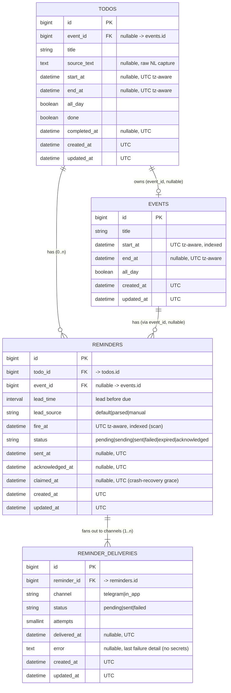

# Calendar + To-Do — Data Model (Stage 03)

- **Feature slug:** `calendar-todo`
- **Stage:** 03 — Database Design
- **Status:** Draft — awaiting approval
- **Author:** Database Design Agent
- **Date:** 2026-11-15
- **Inputs:** `docs/design/calendar-todo/01-requirements.md` (APPROVED),
  `docs/design/calendar-todo/02-architecture.md` (APPROVED)

> Scope note: this document designs the **persistent schema** — tables, columns,
> types, keys, constraints, indexes, relationships/cascades, the retention
> strategy, and the Alembic migration plan. It does **not** run migrations, write
> code under `src/`, design API payloads (stage 04), or implement services
> (stage 05). SQLAlchemy snippets below are the *design target* for stage 05 to
> author verbatim; they are illustrative, not committed code.

---

## 0. Locked decisions that override Stage 02

The user locked the following; where Stage 02 says otherwise, **this document and
these decisions win**:

1. **Module folder is `planner`, not `calendar`.** All code lives in
   `src/modules/planner/`, imported as `modules.planner.*`. The docs/feature slug
   stays `calendar-todo`. Stage 02 §0 / §1 named the directory `calendar/`; that is
   superseded. Everywhere below, model files are `src/modules/planner/models.py`
   and the Alembic import is `import modules.planner.models`.
2. **`notify` (Telegram sender) is built in stage 05, not now.** The schema must
   still carry reminder **delivery state for both channels** (Telegram + in-app)
   so stage 05's sender and the in-app poll feed have a durable backing store on
   day one.
3. **`todos` and `events` are SEPARATE tables**, linked by a **nullable**
   `todos.event_id` FK → `events`. A dated to-do owns an event; a floating to-do
   has `event_id = NULL`.
4. **Datetimes are UTC-on-the-wire and UTC-at-rest** (confirmed against core —
   `SystemMetric.timestamp` uses `sa.DateTime(timezone=True)` and `system/service`
   compares against `datetime.now(timezone.utc)`). This resolves OQ-8 as **store
   UTC / return UTC**; Asia/Bangkok is only the *resolution* timezone inside the
   parser (stage 05).

---

## 1. Conventions inherited from the existing codebase

Verified against `src/core/models.py`, `src/modules/system/models.py`,
`src/core/database.py`, `src/migrations/env.py`:

| Convention | Source | Applied here |
|---|---|---|
| Single declarative `Base` with a `MetaData` naming convention (`pk_`, `fk_`, `ix_`, `uq_`, `ck_`) | `core/models.py` | All three new tables subclass `core.models.Base`; constraint/index names follow the convention automatically. |
| Typed SQLAlchemy 2 (`Mapped[...]` / `mapped_column`) | `system/models.py` | Used throughout. |
| `BigInteger` surrogate PK | `system_metric.id` | `todos.id`, `events.id`, `reminders.id`, `reminder_deliveries.id` are `BigInteger` PKs. |
| Timezone-aware UTC datetimes (`sa.DateTime(timezone=True)`) | `system_metric.timestamp` | Every datetime column uses `sa.DateTime(timezone=True)`; values are UTC instants. |
| `index=True` on hot time columns | `system_metric.timestamp` | Applied to `events.start_at`/`end_at`, `reminders.fire_at`, etc. (composite indexes declared explicitly — see §5). |
| Async sessions (`async with SessionLocal()`) | `core/database.py`, `system/service.py` | Relevant to stage 05, not the schema; noted for cascade behavior choices (DB-level vs ORM-level). |
| Retention via a scheduled `DELETE ... WHERE ts < cutoff` job | `system/service.clean_system_metric` + `scheduler` | Mirrored for fired-reminder pruning (§6). |
| New models imported in `migrations/env.py` | `env.py` line 7 | Add `import modules.planner.models`. |

Rule honored: **no owner/user column anywhere** (FR-22, single-operator).

---

## 2. ER diagram



Four tables: `todos`, `events`, `reminders`, and a per-channel delivery sub-row
`reminder_deliveries`. The sub-row (vs. flag columns) is justified in §4.3.

---

## 3. Table designs

### 3.1 `todos`

The task record. A floating task has `event_id = NULL` and typically no
`start_at`. A dated task has a `start_at` and an owned `event_id`.

| Column | Type | Null | Default | Notes |
|---|---|---|---|---|
| `id` | `BigInteger` | no | identity | PK |
| `event_id` | `BigInteger` | **yes** | — | FK → `events.id`, `ON DELETE SET NULL`. NULL = floating (FR-6). |
| `title` | `String(255)` | no | — | required (FR-1). |
| `source_text` | `Text` | yes | — | raw NL input captured verbatim (FR-1, FR-9 traceability). NULL for structured create (FR-11). |
| `start_at` | `DateTime(timezone=True)` | yes | — | due datetime, UTC. NULL = floating (FR-6/26). |
| `end_at` | `DateTime(timezone=True)` | yes | — | optional end, UTC (FR-1). |
| `all_day` | `Boolean` | no | `false` | (FR-1). |
| `done` | `Boolean` | no | `false` | completion flag (FR-14). |
| `completed_at` | `DateTime(timezone=True)` | yes | — | set when `done` flips true; nullable when incomplete (FR-14, retention/archival OQ-7). |
| `created_at` | `DateTime(timezone=True)` | no | `now()` (server) | audit. |
| `updated_at` | `DateTime(timezone=True)` | no | `now()`, `onupdate=now()` | audit. |

- **PK:** `pk_todos (id)`.
- **FK:** `fk_todos_event_id_events (event_id) → events.id ON DELETE SET NULL`.
- **Unique:** `uq_todos_event_id (event_id)` — a given event is owned by **at most
  one** to-do (the link is 1:1 on the todo→event side). NULLs are allowed/repeated
  in Postgres, so many floating to-dos coexist; only non-null `event_id` values are
  unique.
- **Indexes:** see §5.

Illustrative SQLAlchemy 2 (stage-05 target, not committed):

```python
from datetime import datetime
import sqlalchemy as sa
from sqlalchemy.orm import Mapped, mapped_column, relationship
from core.models import Base


class Todo(Base):
    __tablename__ = "todos"
    __table_args__ = (
        sa.UniqueConstraint("event_id", name="uq_todos_event_id"),
        sa.Index("ix_todos_done_start_at", "done", "start_at"),
    )

    id: Mapped[int] = mapped_column(sa.BigInteger, primary_key=True)
    event_id: Mapped[int | None] = mapped_column(
        sa.BigInteger,
        sa.ForeignKey("events.id", ondelete="SET NULL"),
        nullable=True,
    )
    title: Mapped[str] = mapped_column(sa.String(255), nullable=False)
    source_text: Mapped[str | None] = mapped_column(sa.Text, nullable=True)
    start_at: Mapped[datetime | None] = mapped_column(
        sa.DateTime(timezone=True), nullable=True
    )
    end_at: Mapped[datetime | None] = mapped_column(
        sa.DateTime(timezone=True), nullable=True
    )
    all_day: Mapped[bool] = mapped_column(
        sa.Boolean, nullable=False, server_default=sa.false()
    )
    done: Mapped[bool] = mapped_column(
        sa.Boolean, nullable=False, server_default=sa.false()
    )
    completed_at: Mapped[datetime | None] = mapped_column(
        sa.DateTime(timezone=True), nullable=True
    )
    created_at: Mapped[datetime] = mapped_column(
        sa.DateTime(timezone=True), nullable=False, server_default=sa.func.now()
    )
    updated_at: Mapped[datetime] = mapped_column(
        sa.DateTime(timezone=True),
        nullable=False,
        server_default=sa.func.now(),
        onupdate=sa.func.now(),
    )

    event: Mapped["Event | None"] = relationship(
        back_populates="todo", foreign_keys=[event_id]
    )
    reminders: Mapped[list["Reminder"]] = relationship(
        back_populates="todo",
        cascade="all, delete-orphan",
        passive_deletes=True,
    )
```

### 3.2 `events`

A calendar time block. Always has a `start_at` (an event only exists when there is
a time — FR-5/19). Range-queried with overlap semantics (FR-18/20).

| Column | Type | Null | Default | Notes |
|---|---|---|---|---|
| `id` | `BigInteger` | no | identity | PK |
| `title` | `String(255)` | no | — | (FR-19). |
| `start_at` | `DateTime(timezone=True)` | no | — | UTC; event always has a start (FR-19). |
| `end_at` | `DateTime(timezone=True)` | yes | — | UTC; optional (FR-19). See OQ-A on overlap when NULL. |
| `all_day` | `Boolean` | no | `false` | (FR-19). |
| `created_at` | `DateTime(timezone=True)` | no | `now()` | audit. |
| `updated_at` | `DateTime(timezone=True)` | no | `now()`, `onupdate` | audit. |

- **PK:** `pk_events (id)`.
- **No FK back to `todos`.** The back-reference "source todo (if any)" (FR-19) is
  derived from `todos.event_id` to avoid a mutual-FK circular dependency at
  migration time. The ORM exposes `Event.todo` via `relationship(back_populates=...)`
  over the `todos.event_id` FK — no column on `events`.
- **Indexes:** overlap-range index — see §5.

```python
class Event(Base):
    __tablename__ = "events"
    __table_args__ = (sa.Index("ix_events_start_end", "start_at", "end_at"),)

    id: Mapped[int] = mapped_column(sa.BigInteger, primary_key=True)
    title: Mapped[str] = mapped_column(sa.String(255), nullable=False)
    start_at: Mapped[datetime] = mapped_column(
        sa.DateTime(timezone=True), nullable=False
    )
    end_at: Mapped[datetime | None] = mapped_column(
        sa.DateTime(timezone=True), nullable=True
    )
    all_day: Mapped[bool] = mapped_column(
        sa.Boolean, nullable=False, server_default=sa.false()
    )
    created_at: Mapped[datetime] = mapped_column(
        sa.DateTime(timezone=True), nullable=False, server_default=sa.func.now()
    )
    updated_at: Mapped[datetime] = mapped_column(
        sa.DateTime(timezone=True),
        nullable=False,
        server_default=sa.func.now(),
        onupdate=sa.func.now(),
    )

    todo: Mapped["Todo | None"] = relationship(
        back_populates="event", foreign_keys="Todo.event_id"
    )
    reminders: Mapped[list["Reminder"]] = relationship(
        back_populates="event",
        passive_deletes=True,
    )
```

### 3.3 `reminders`

A scheduled lead-time notification bound to a **dated** item. `todo_id` is the
owning to-do (always present — every reminder belongs to a to-do, FR-23/26); the
optional `event_id` mirrors the to-do's event so the scan/recompute can key off
either. `fire_at` is the resolved **absolute UTC instant** the reminder must fire;
it is `due - lead_time` computed at write time (FR-23).

| Column | Type | Null | Default | Notes |
|---|---|---|---|---|
| `id` | `BigInteger` | no | identity | PK |
| `todo_id` | `BigInteger` | no | — | FK → `todos.id`, `ON DELETE CASCADE`. Owning item. |
| `event_id` | `BigInteger` | yes | — | FK → `events.id`, `ON DELETE CASCADE`. Mirror of the todo's event, if dated. |
| `lead_time` | `Interval` | no | — | lead before due (e.g. `1 day`, `2 hours`) (FR-23/24/25). Postgres `INTERVAL`. |
| `lead_source` | `String(16)` | no | `'default'` | `default` \| `parsed` \| `manual` — provenance for FR-9 visible-assumption + FR-27/28. |
| `fire_at` | `DateTime(timezone=True)` | no | — | resolved UTC fire instant = `due - lead_time`. **Scan key.** |
| `status` | `String(16)` | no | `'pending'` | `pending` \| `sending` \| `sent` \| `failed` \| `expired` \| `acknowledged`. Durable exactly-once gate (FR-32/33, NFR-18). |
| `sent_at` | `DateTime(timezone=True)` | yes | — | when the fan-out completed (UTC). |
| `acknowledged_at` | `DateTime(timezone=True)` | yes | — | in-app dismiss (FR-31a). |
| `claimed_at` | `DateTime(timezone=True)` | yes | — | set when a scan claims the row (`pending→sending`); used for the stale-`sending` crash grace (§4.2). |
| `created_at` | `DateTime(timezone=True)` | no | `now()` | audit. |
| `updated_at` | `DateTime(timezone=True)` | no | `now()`, `onupdate` | audit. |

- **PK:** `pk_reminders (id)`.
- **FKs:** `fk_reminders_todo_id_todos (todo_id) → todos.id ON DELETE CASCADE`;
  `fk_reminders_event_id_events (event_id) → events.id ON DELETE CASCADE`.
- **Check constraint:** `ck_reminders_status` restricting `status` to the enum set
  (string + CHECK rather than a PG `ENUM` type — avoids Alembic enum-migration
  friction and matches the project's lightweight style). Same for `lead_source`.
- **Indexes:** the scan index on `(status, fire_at)` — see §5. This is the single
  most performance-critical index in the feature.

```python
class Reminder(Base):
    __tablename__ = "reminders"
    __table_args__ = (
        sa.Index("ix_reminders_status_fire_at", "status", "fire_at"),
        sa.Index("ix_reminders_todo_id", "todo_id"),
        sa.CheckConstraint(
            "status IN ('pending','sending','sent','failed','expired','acknowledged')",
            name="ck_reminders_status",
        ),
        sa.CheckConstraint(
            "lead_source IN ('default','parsed','manual')",
            name="ck_reminders_lead_source",
        ),
    )

    id: Mapped[int] = mapped_column(sa.BigInteger, primary_key=True)
    todo_id: Mapped[int] = mapped_column(
        sa.BigInteger,
        sa.ForeignKey("todos.id", ondelete="CASCADE"),
        nullable=False,
    )
    event_id: Mapped[int | None] = mapped_column(
        sa.BigInteger,
        sa.ForeignKey("events.id", ondelete="CASCADE"),
        nullable=True,
    )
    lead_time: Mapped[timedelta] = mapped_column(sa.Interval, nullable=False)
    lead_source: Mapped[str] = mapped_column(
        sa.String(16), nullable=False, server_default="default"
    )
    fire_at: Mapped[datetime] = mapped_column(
        sa.DateTime(timezone=True), nullable=False
    )
    status: Mapped[str] = mapped_column(
        sa.String(16), nullable=False, server_default="pending"
    )
    sent_at: Mapped[datetime | None] = mapped_column(
        sa.DateTime(timezone=True), nullable=True
    )
    acknowledged_at: Mapped[datetime | None] = mapped_column(
        sa.DateTime(timezone=True), nullable=True
    )
    claimed_at: Mapped[datetime | None] = mapped_column(
        sa.DateTime(timezone=True), nullable=True
    )
    created_at: Mapped[datetime] = mapped_column(
        sa.DateTime(timezone=True), nullable=False, server_default=sa.func.now()
    )
    updated_at: Mapped[datetime] = mapped_column(
        sa.DateTime(timezone=True),
        nullable=False,
        server_default=sa.func.now(),
        onupdate=sa.func.now(),
    )

    todo: Mapped["Todo"] = relationship(back_populates="reminders")
    event: Mapped["Event | None"] = relationship(back_populates="reminders")
    deliveries: Mapped[list["ReminderDelivery"]] = relationship(
        back_populates="reminder",
        cascade="all, delete-orphan",
        passive_deletes=True,
    )
```

> Note `from datetime import timedelta` is required for `Interval` typing.

### 3.4 `reminder_deliveries` (per-channel sub-row)

One row per `(reminder, channel)` capturing that channel's independent outcome.
This is the durable backing store for **both** channels even though `notify` is
built later (decision #2): the in-app poll feed reads `channel='in_app'` rows, and
the stage-05 Telegram sender updates `channel='telegram'` rows.

| Column | Type | Null | Default | Notes |
|---|---|---|---|---|
| `id` | `BigInteger` | no | identity | PK |
| `reminder_id` | `BigInteger` | no | — | FK → `reminders.id`, `ON DELETE CASCADE`. |
| `channel` | `String(16)` | no | — | `telegram` \| `in_app` (FR-30/31). |
| `status` | `String(16)` | no | `'pending'` | `pending` \| `sent` \| `failed` — per-channel independent outcome (FR-31, NFR-20). |
| `attempts` | `SmallInteger` | no | `0` | retry counter (NFR-20, bounded retry; policy OQ-15). |
| `delivered_at` | `DateTime(timezone=True)` | yes | — | success timestamp, UTC. |
| `error` | `Text` | yes | — | last failure detail; **no secrets** (NFR-21). |
| `created_at` | `DateTime(timezone=True)` | no | `now()` | audit. |
| `updated_at` | `DateTime(timezone=True)` | no | `now()`, `onupdate` | audit. |

- **PK:** `pk_reminder_deliveries (id)`.
- **FK:** `fk_reminder_deliveries_reminder_id_reminders (reminder_id) → reminders.id ON DELETE CASCADE`.
- **Unique:** `uq_reminder_deliveries_reminder_id_channel (reminder_id, channel)` —
  exactly one delivery sub-row per channel per reminder (idempotency; prevents
  duplicate channel rows on retry/restart).
- **Check:** `ck_reminder_deliveries_channel` (`in ('telegram','in_app')`) and
  `ck_reminder_deliveries_status`.
- **Indexes:** in-app poll index — see §5.

```python
class ReminderDelivery(Base):
    __tablename__ = "reminder_deliveries"
    __table_args__ = (
        sa.UniqueConstraint(
            "reminder_id",
            "channel",
            name="uq_reminder_deliveries_reminder_id_channel",
        ),
        sa.Index(
            "ix_reminder_deliveries_inapp_feed",
            "channel",
            "status",
            "delivered_at",
        ),
        sa.CheckConstraint(
            "channel IN ('telegram','in_app')",
            name="ck_reminder_deliveries_channel",
        ),
        sa.CheckConstraint(
            "status IN ('pending','sent','failed')",
            name="ck_reminder_deliveries_status",
        ),
    )

    id: Mapped[int] = mapped_column(sa.BigInteger, primary_key=True)
    reminder_id: Mapped[int] = mapped_column(
        sa.BigInteger,
        sa.ForeignKey("reminders.id", ondelete="CASCADE"),
        nullable=False,
    )
    channel: Mapped[str] = mapped_column(sa.String(16), nullable=False)
    status: Mapped[str] = mapped_column(
        sa.String(16), nullable=False, server_default="pending"
    )
    attempts: Mapped[int] = mapped_column(
        sa.SmallInteger, nullable=False, server_default="0"
    )
    delivered_at: Mapped[datetime | None] = mapped_column(
        sa.DateTime(timezone=True), nullable=True
    )
    error: Mapped[str | None] = mapped_column(sa.Text, nullable=True)
    created_at: Mapped[datetime] = mapped_column(
        sa.DateTime(timezone=True), nullable=False, server_default=sa.func.now()
    )
    updated_at: Mapped[datetime] = mapped_column(
        sa.DateTime(timezone=True),
        nullable=False,
        server_default=sa.func.now(),
        onupdate=sa.func.now(),
    )

    reminder: Mapped["Reminder"] = relationship(back_populates="deliveries")
```

---

## 4. Relationships, cardinality & cascade behavior

### 4.1 todo ↔ event (1:0..1, owned by todo)

- **Cardinality:** a to-do has **0 or 1** event (`todos.event_id` nullable, unique).
  An event is owned by **at most one** to-do.
- **Link direction:** the FK lives on **`todos`** (`event_id`). `events` carries no
  FK back, avoiding a circular FK at create time; the back-ref is ORM-derived.
- **Cascade on event delete:** `todos.event_id ON DELETE SET NULL`. Deleting an
  event un-dates the to-do rather than destroying the task (user-authored data is
  precious — NFR-23). Service logic (stage 05) decides whether removing a time also
  clears `start_at`/reminders (FR-16/17); the DB default keeps the to-do alive.
- **Cascade on todo delete:** deleting a to-do does **not** DB-cascade to its event
  (no FK in that direction). Per FR-16 the *rule* (cascade the event, orphan it, or
  forbid) is **OQ-2, still open** — see §8. **Recommended default:** service-level
  cascade — when a to-do is deleted, the service deletes the owned event in the same
  transaction. This is enforced in code (stage 05), not by a DB FK, because the FK
  points the other way. Flagged for sign-off.

### 4.2 reminder → todo / event (N:1)

- **Cardinality:** a dated item has **0..N** reminders (model allows many per
  FR-23/OQ-11; v1 may ship one). Each reminder belongs to exactly one `todo` and
  optionally mirrors one `event`.
- **Cascade:** `reminders.todo_id ON DELETE CASCADE` and
  `reminders.event_id ON DELETE CASCADE`. Deleting the owning to-do (or its event)
  removes its reminders — reminders have no meaning without their item, and we must
  not fire a reminder for a deleted task. `passive_deletes=True` on the ORM side so
  the DB performs the cascade (no ORM pre-load).
- **Recompute on due change (FR-29):** handled in service code — pending reminders
  are recomputed (`fire_at = new_due - lead_time`); `sent`/`acknowledged` reminders
  are left untouched (the `status` gate prevents re-fire). No schema change needed;
  `status` + `fire_at` carry the state.

### 4.3 reminder → deliveries (1:N, per channel) — **sub-row vs. flags justification**

**Decision: separate `reminder_deliveries` sub-rows, not boolean flag columns on
`reminders`.** Rationale:

- **Independent per-channel outcomes (FR-31, NFR-20):** channels must fail
  independently — Telegram can fail while in-app succeeds. A sub-row holds
  per-channel `status`, `attempts`, `error`, `delivered_at` without widening
  `reminders` with `telegram_status`/`inapp_status`/`telegram_error`/… column
  sprawl that must grow every time a channel is added.
- **Extensibility (FR-31 "adding/removing a channel shall not change scheduling"):**
  a new channel = a new row value, zero schema change to `reminders`.
- **Bounded retry (NFR-20):** `attempts` is naturally per-channel.
- **In-app feed query (FR-31a):** the poll feed is "fired, not-yet-acknowledged
  in-app deliveries" — a clean indexed read of `reminder_deliveries WHERE
  channel='in_app'` joined to `reminders` for ack state. Flags would force the feed
  to scan `reminders` and re-derive channel state.
- **Trade-off:** one extra table + a join. Acceptable: volumes are tiny
  (single-user, a handful of reminders/day) and the normalized shape is correct.
  The `reminders.status` column remains the **exactly-once firing gate** (one
  decision per reminder); the sub-rows record **per-channel delivery facts**. These
  are two different concerns and are kept separate on purpose.

**Why `reminders.status` stays the firing gate (exactly-once, crash-safe —
FR-32/33, NFR-18):** the scan claims a row with a guarded update
`UPDATE reminders SET status='sending', claimed_at=now() WHERE id=? AND
status='pending'` (one-shot, single-writer A-5 makes contention nil but the guard
makes it correct regardless). On success → `status='sent', sent_at=now()`. A crash
mid-dispatch leaves `status='sending'`; the next scan treats `sending` rows older
than a grace window (`claimed_at < now() - grace`) as re-claimable, accepting rare
at-least-once to Telegram (true cross-crash exactly-once to an external API is
impossible without an outbox — Stage 02 §5 / risk accepted). The `(reminder_id,
channel)` unique on deliveries plus per-channel `status` means a re-dispatch
updates the existing delivery row instead of duplicating it.

---

## 5. Indexes (query-driven)

| Index | Table | Columns | Serves | Why |
|---|---|---|---|---|
| `ix_reminders_status_fire_at` | `reminders` | `(status, fire_at)` | **Reminder scan** `WHERE status='pending' AND fire_at <= now()` (FR-32, NFR-19) | Leading equality on `status` then range on `fire_at` → index-only range scan of just the pending tail; the dominant hot query, runs every 30–60 s on the shared event loop, must stay cheap. |
| `ix_events_start_end` | `events` | `(start_at, end_at)` | **Calendar overlap range** `from`/`to` (FR-18/20) | Overlap predicate `start_at <= :to AND (end_at >= :from OR end_at IS NULL)`; composite supports the `start_at` bound + ordering; `end_at` as 2nd col aids the overlap filter. Ordered by `start_at` for rendering. |
| `ix_todos_done_start_at` | `todos` | `(done, start_at)` | **To-do list filter** by completion + date (FR-12, AC-5) | Equality on `done` then range/order on `start_at`; the primary list query. Floating todos (`start_at IS NULL`) sort to one end. |
| `uq_todos_event_id` | `todos` | `(event_id)` unique | 1:1 todo→event enforcement; fast todo-by-event lookup | Prevents two todos owning one event; NULLs allowed/duplicated. |
| `ix_reminders_todo_id` | `reminders` | `(todo_id)` | Recompute/clear reminders for an item (FR-28/29); cascade support | Fetch an item's reminders on due change / delete. |
| `ix_reminder_deliveries_inapp_feed` | `reminder_deliveries` | `(channel, status, delivered_at)` | **In-app poll feed** (FR-31a) | `WHERE channel='in_app' AND status='sent'` ordered by `delivered_at`; ack state joined from `reminders.acknowledged_at`. |
| `uq_reminder_deliveries_reminder_id_channel` | `reminder_deliveries` | `(reminder_id, channel)` unique | one row per channel per reminder | idempotent delivery recording. |

Notes:
- The scan index `(status, fire_at)` is intentionally **status-first**: `pending`
  is a tiny slice of the table over time (most rows are `sent`), so the equality
  prefix keeps the scanned range minimal as history accumulates. A partial index
  `WHERE status IN ('pending','sending')` is a possible future optimization but is
  **not** proposed for v1 (keeps the migration simple; single-user volume is low).
- No GiST/range-type index for event overlap — at single-user scale a plain
  B-tree composite is ample; a `tstzrange` + GiST would be over-engineering.

---

## 6. Retention strategy

Maps NFR-23 and the metrics-style retention pattern already in the repo.

### 6.1 User-authored records — retained indefinitely

`todos` and `events` are **never** auto-pruned or rolled up (NFR-23). This is the
explicit opposite of the `system_metric` 7-day `DELETE` job. No retention job
touches these two tables. (Whether completed/old items are *archived* is **OQ-7**,
out of scope for v1 — the `completed_at` column exists so a future archival job has
a key to work from without a schema change.)

### 6.2 Fired reminders — bounded pruning

Reminders are operational records, not user content. Per NFR-23 ("fired-reminder
records may be pruned/archived once acknowledged and past"):

- **Keep** `pending` / `sending` reminders forever (they are live work).
- **Prune** reminders that are terminal **and** past: `status IN
  ('sent','acknowledged','expired')` **and** `fire_at < now() - RETENTION`, cascading
  to their `reminder_deliveries` rows (via `ON DELETE CASCADE`).
- `RETENTION` is a settings value (e.g. `REMINDER_RETENTION_DAYS`, default ~30 days)
  — **not hard-coded**, mirroring the `clean_system_metric(retention_days)` pattern.
- **Job:** a scheduled `DELETE` on the **existing shared `AsyncIOScheduler`**
  (`modules/scheduler/scheduler.py`), daily cadence, exactly like
  `scheduler_clean_system_metric` — a new `scheduler_clean_reminders()` registering
  a `clean_fired_reminders()` service coroutine. No partitioning: single-user volume
  (a few reminders/day) never approaches the metrics table's ~1200 rows/hr; a plain
  indexed `DELETE` is sufficient. Design target (stage 05):

  ```python
  async def clean_fired_reminders(retention_days: int = 30):
      cutoff = datetime.now(timezone.utc) - timedelta(days=retention_days)
      async with SessionLocal() as session:
          result = await session.execute(
              delete(Reminder).where(
                  Reminder.status.in_(("sent", "acknowledged", "expired")),
                  Reminder.fire_at < cutoff,
              )
          )
          await session.commit()
      return result.rowcount
  ```

- **No partitioning / no rollup.** Unlike `system_metric` (time-series,
  high-ingest), none of these four tables are high-volume time-series; the
  retention concern is only unbounded growth of stale reminder history, solved by
  the daily `DELETE` above. The scan index `(status, fire_at)` doubles as the
  retention-query index.

### 6.3 Missed-reminder catch-up (FR-34) interaction with retention

On restart the first scan picks up any `pending` reminder with `fire_at <= now()`,
including ones whose time passed during downtime. The catch-up cutoff (OQ-13) is a
**runtime** decision (deliver if `now() - fire_at < CATCHUP_WINDOW`, else transition
to `status='expired'`), **not** a retention delete — `expired` rows are then subject
to the §6.2 prune. No schema support beyond the existing `status` value is needed;
`expired` is already in the status check set.

---

## 7. Mapping to functional requirements

| FR / AC | Schema element |
|---|---|
| FR-1, FR-19 | `title`, `start_at`, `end_at`, `all_day` on `todos`/`events`. |
| FR-1 (capture source) | `todos.source_text` stores raw NL text. |
| FR-5 / AC-1 | dated todo → `events` row + `todos.event_id` link + `reminders` row. |
| FR-6 / AC-2 | floating todo = `event_id NULL`, `start_at NULL`, no reminder. |
| FR-11 / AC-4 | structured create = same tables, `source_text NULL`. |
| FR-12 / AC-5 | `ix_todos_done_start_at` supports done+date filter. |
| FR-14 | `todos.done` + `completed_at`. |
| FR-16 | `todos.event_id ON DELETE SET NULL`; todo-delete→event rule = OQ-2 (service-level). |
| FR-17 | service mutates `event_id` + reminders; schema permits NULL↔set transitions. |
| FR-18/20 / AC-6 | `ix_events_start_end` for overlap range query. |
| FR-22 | no owner column anywhere. |
| FR-23 / OQ-11 | `reminders` is N-per-item (FK, not 1:1). |
| FR-24/25 | `lead_time` + `lead_source='default'`; default value is settings-driven. |
| FR-26 / AC-12 | reminders require `todo.start_at`; floating → no `reminders` row. |
| FR-27/28 | `lead_source ∈ {parsed, manual}`. |
| FR-29 | `fire_at` recomputed in service; `status` guards fired ones. |
| FR-30/31 | `reminder_deliveries(channel ∈ {telegram, in_app})`, independent `status`. |
| FR-31a / AC-13 ack | in-app feed via `ix_reminder_deliveries_inapp_feed`; `reminders.acknowledged_at`. |
| FR-32 / AC-9 | `reminders.status` guarded transition = exactly-once gate; `ix_reminders_status_fire_at` scan. |
| FR-33 / AC-13 | state persisted in Postgres (`status`, `fire_at`, `claimed_at`); survives restart. |
| FR-34 / AC-14 | first scan picks `pending AND fire_at<=now()`; late→`expired`. |
| NFR-9 / AC-8 | all datetimes `DateTime(timezone=True)` UTC. |
| NFR-18 | guarded `pending→sending→sent` + `(reminder_id, channel)` unique = idempotent. |
| NFR-19 | cheap indexed scan via `(status, fire_at)`. |
| NFR-23 | `todos`/`events` never pruned; fired reminders pruned by daily `DELETE`. |

---

## 8. Open questions needing sign-off (schema-level)

These affect the schema or its constraints and should be confirmed **before stage
05 writes models**:

1. **OQ-2 / FR-16 — todo-delete → event behavior.** The DB handles *event-delete →
   todo* (`SET NULL`). The reverse (*todo-delete → its owned event*) has **no DB
   FK** (FK points todo→event), so it is a **service-level** rule. Recommended:
   service cascade-deletes the owned event in the same transaction. **Confirm**:
   cascade (recommended), orphan the event as a standalone calendar block, or
   forbid deleting a dated todo? Also: **can an event exist with no parent todo?**
   This schema *allows* it (events have no mandatory back-FK) — confirm that
   standalone events are acceptable even if v1's UX never creates one.
2. **OQ-3 — default duration / `end_at` nullability on events.** `events.end_at` is
   nullable. If the overlap range query must treat a null-`end_at` event as a point
   or give it a default duration, that shapes the overlap predicate (and possibly a
   `server_default`/computed column). Current design: `end_at NULL` treated as a
   point (`end_at := start_at` in the query). Confirm, or lock a default duration.
3. **OQ-11 — multiple reminders per item in v1.** Schema allows many. If v1 ships
   exactly one, do we add a `uq_reminders_todo_id` (one reminder per todo)
   constraint, or leave it open? Recommended: **leave open** (no unique) so the
   model does not preclude many (FR-23 explicitly requires this); UX limits to one.
4. **OQ-14 — per-reminder channel selection.** Design pre-creates both
   `reminder_deliveries` rows (telegram + in_app) at fire time. If the operator can
   choose channels per reminder, we need a selection store — options: (a) create
   only the chosen channels' delivery rows, (b) add a `reminders.channels`
   array/flags column. Recommended: (a), no extra column — absence of a channel row
   = not selected. Confirm whether per-reminder selection is in v1 at all (Stage 01
   OQ-14) or fixed "both".
5. **`lead_time` type.** Proposed Postgres `INTERVAL` (`sa.Interval`). Alternative:
   store integer seconds. `INTERVAL` is more expressive and maps cleanly to
   `timedelta`; psycopg3 handles it. Confirm `INTERVAL` is acceptable (it is the
   first use of `INTERVAL` in this codebase).
6. **Status as `String`+CHECK vs PG `ENUM`.** Chosen `String(16)` + CHECK to avoid
   Alembic enum-alter pain and match the project's lightweight style. Confirm this
   over a native `ENUM` type.
7. **Reminder retention default.** Proposed `REMINDER_RETENTION_DAYS` default ~30.
   Confirm the value (and that fired-reminder pruning is wanted at all vs. keep
   forever — ties to OQ-7).

---

## 9. Migration strategy (Alembic)

**Design only — do NOT run migrations here. Executed in stage 05.**

### 9.1 How it autogenerates

1. Stage 05 creates `src/modules/planner/models.py` with the four models above
   (subclassing `core.models.Base`).
2. Stage 05 **edits `src/migrations/env.py`** to add the import so autogenerate sees
   the tables:

   ```python
   import modules.system.models  # noqa: F401   (existing)
   import modules.planner.models  # noqa: F401   (ADD THIS)
   ```

   Without this line the tables are invisible to autogenerate (the critical repo
   rule). `target_metadata = Base.metadata` already covers them once imported.
3. From `src/`:
   ```bash
   cd src && uv run alembic revision --autogenerate -m "create planner todos events reminders"
   cd src && uv run alembic upgrade head
   ```

### 9.2 Ordered steps within the single migration

Autogenerate must emit `create_table` in **FK-dependency order**. Because
`todos.event_id → events` and `reminders.{todo_id,event_id} → todos/events`, the
order is:

1. `events` (no outgoing FK).
2. `todos` (FK → `events`).
3. `reminders` (FK → `todos`, `events`).
4. `reminder_deliveries` (FK → `reminders`).
5. Indexes + unique + check constraints per §3/§5.

Verify the autogenerated script orders these correctly (Alembic usually does, but
the mutual todo/event relationship is the one to eyeholler-check); reorder by hand
if needed. The naming convention in `core/models.py` yields the constraint names
used above automatically — do not hand-name them differently.

> **Note on `INTERVAL` and CHECK constraints:** autogenerate renders `sa.Interval`
> as `INTERVAL` and the `CheckConstraint`s inline; confirm they appear in the
> generated `upgrade()` (CHECK constraints are emitted when declared in
> `__table_args__`, which they are).

### 9.3 Data backfill

**None.** These are brand-new tables with no pre-existing data to migrate. First
deploy starts empty.

### 9.4 Rollback

`downgrade()` drops in reverse FK order:
`reminder_deliveries` → `reminders` → `todos` → `events` (with their indexes).
Autogenerate produces this; verify the drop order mirrors the create order
reversed. No data-preserving concerns since the feature is additive and new.

### 9.5 Settings touched (context for stage 05, not schema)

The retention job needs `REMINDER_RETENTION_DAYS` (and the reminder subsystem
needs the Stage-02 settings). These live in `core/config.py`, not the schema — out
of scope here, flagged so stage 05 wires the daily prune job into
`modules/scheduler/scheduler.py` alongside `clean_system_metric`.

---

## Handoff

### Entities/fields the API & Contract Agent (stage 04) will expose

- **Todo:** `id`, `title`, `source_text?`, `start_at?`, `end_at?`, `all_day`,
  `done`, `completed_at?`, `event_id?`, `created_at`, `updated_at`. All datetimes
  **UTC on the wire**. Floating = `start_at`/`event_id` null.
- **Event:** `id`, `title`, `start_at`, `end_at?`, `all_day`, derived
  `todo_id?` (source todo), `created_at`, `updated_at`. Range query `from`/`to`
  returns overlapping events ordered by `start_at`.
- **Reminder:** `id`, `todo_id`, `event_id?`, `lead_time`, `lead_source`,
  `fire_at`, `status`, `sent_at?`, `acknowledged_at?`. In-app poll feed derives
  from `reminder_deliveries(channel='in_app', status='sent')` joined to the
  reminder's `acknowledged_at`; ack endpoint sets `reminders.acknowledged_at`.
- **ReminderDelivery:** `channel`, `status`, `attempts`, `delivered_at?`, `error?`
  — mostly internal; the in-app channel's rows surface through the poll feed.

### Exact files the Backend Implementation Agent (stage 05) must create/edit

- **Create** `src/modules/planner/models.py` — the four models `Todo`, `Event`,
  `Reminder`, `ReminderDelivery` exactly as §3 (subclass `core.models.Base`, typed
  `Mapped`/`mapped_column`, UTC tz-aware datetimes, constraints/indexes per §5).
- **Edit** `src/migrations/env.py` — add `import modules.planner.models  # noqa: F401`
  next to the existing `import modules.system.models`.
- **Generate** one Alembic revision (`create planner todos events reminders`) and
  `alembic upgrade head`, verifying FK create order `events → todos → reminders →
  reminder_deliveries` (§9.2) and that `INTERVAL` + CHECK constraints render.
- **Later (same stage, retention):** add `clean_fired_reminders()` to the planner
  service and `scheduler_clean_reminders()` to `modules/scheduler/scheduler.py`
  (daily), mirroring `clean_system_metric`; add `REMINDER_RETENTION_DAYS` to
  `core/config.py`.

### Migration ordering

Single migration, tables created `events → todos → reminders →
reminder_deliveries`; downgrade in reverse. No backfill.

### Gate

**Do not start stage 04 until this data model is approved by the human operator.**
Seven schema-level open questions in §8 (notably OQ-2 todo-delete→event cascade,
OQ-14 per-reminder channels, `INTERVAL` type, and status-as-CHECK) need sign-off,
as they change constraints/columns before stage 05 writes the models.
